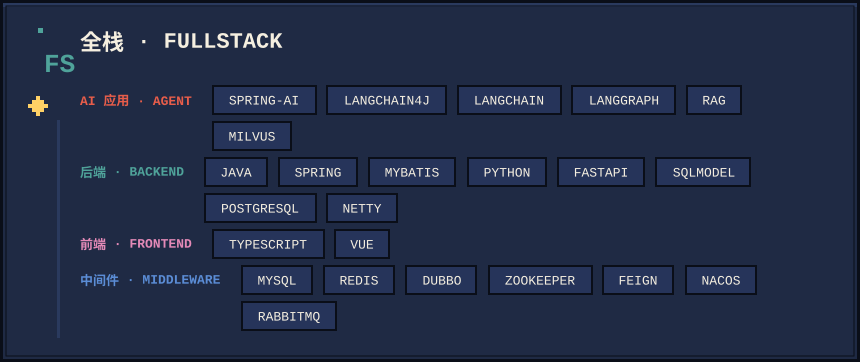

<!-- ═══════════════════ HERO · 手绘 + 像素 大横幅 ═══════════════════ -->

<!-- 手绘波浪分隔条 -->

<!-- ═══════════════════ 关于我 ═══════════════════ -->

你好呀 👋 欢迎来到我的 GitHub 主页，我是 **Erywim**，一名专注于 **AI 应用层** 的全栈工程师。

- 🔭 白天在写：**Agent 应用 / RAG 全链路 / LLM 工程化**
- 🌱 晚上在啃：机器学习 / 深度学习 ，以及 **ClaudeCode / Hermes 等 Agent 源码**
- 💬 可以聊：Java · Python · AI 应用落地 · 并发编程

<!-- ═══════════════════ 技术栈 ═══════════════════ -->

<!-- ── 全栈 ── -->

  
  

<!-- ═══════════════════ Footer ═══════════════════ -->

<!-- 联系我：把下面这行的占位换成你的真实链接，或者删掉 -->
<!-- 📮 Email · 🐦 Twitter · ✍️ 博客 —— 见个人资料页右侧 -->
