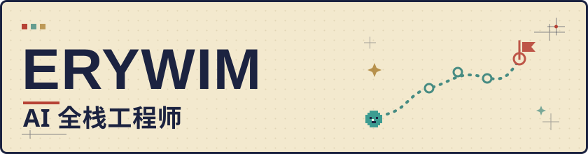

  <picture>
    <source media="(prefers-color-scheme: dark)" srcset="assets/hero-dark.svg">
    <source media="(prefers-color-scheme: light)" srcset="assets/hero-light.svg">
    
  </picture>

  <strong>把模型能力，做成能用的产品。</strong> 
  AI 全栈工程师 · Agent 应用方向

  <a href="https://erywim.github.io/">个人站</a> ·
  <a href="https://erywim.github.io/blog/">技术笔记</a> ·
  <a href="mailto:erywim@163.com">Email</a>

---

## NOW / 现在

- **在做** [pi-amadeus](https://github.com/erywim/pi-amadeus)：基于 Pi Agent 的个人助手，正在打通实时语音、Live2D 与多端对话。
- **在学** 深度学习基础；读 Claude Code / Hermes 的 Agent 源码。
- **关注** 长任务状态管理、工具调用可靠性、记忆与评测。
- **可聊** Agent 工程、RAG、Java / TypeScript，以及动漫、摄影和游戏。

## PROJECTS / 项目

### [pi-amadeus](https://github.com/erywim/pi-amadeus) · 进行中

基于 Pi Agent 的个人助手，把实时语音、Live2D 和飞书接进同一个对话系统。

`TypeScript` · `Electron` · `React` · `PostgreSQL`

### [erywim.github.io](https://erywim.github.io/) · 维护中

用像素 RPG 的方式记录技术、生活和实验。

`Astro` · `TypeScript`

[Website →](https://erywim.github.io/) · [Source →](https://github.com/erywim/erywim.github.io)

## TRACK RECORD / 经历

- **2025.09 — 2026.08** 某 AI 科技公司 · AI 全栈（Agent 方向） 志愿填报 Agent、LLM 网关。
- **2023.03 — 2025.08** 某通信行业软件公司 · Java 开发 → 项目经理
- **2019.09 — 2023.07** 软件工程

## WHAT I DO / 做什么

### Agent 应用与编排

拆任务、接工具、管状态，把开放任务跑通。

### RAG 与上下文工程

从解析、召回、重排到压缩，搭好检索链路。

### 实时交互与多端

把文字、语音、Live2D 和桌面 / 飞书接进同一个对话体验。

### 工程实现与交付

Java / Python / TypeScript 落地，从 API、数据到界面都能接。

## TOOLBOX / 技术栈

- **Agent** — `Spring AI` `LangChain4j` `LangGraph` `MCP`
- **Retrieval** — `Milvus` `BM25 + Dense` `Rerank` `MinerU`
- **Engineering** — `Java` `Python` `TypeScript` `Spring Boot` `FastAPI` `PostgreSQL` `Redis` `Kafka`
- **Interface** — `Vue` `React` `NextJS`
- **Model basics** — `Prompt / Context / Harness Engineering` `Transformer` `KV-Cache` `MoE`

<strong>完整技术栈 · 六类</strong>

- **Agent 应用框架** — `Spring AI`、`LangChain4j`、`LangChain`、`LangGraph`、`SSE`、`Function Calling`、`MCP`、`Skill / SOP 提炼`、`Dify`、`Claude Code`
- **Agent 编排范式** — `ReAct`、`Plan-and-Execute`、`Self-Reflection`、`Multi-Agent`、`A2A 协议`、`长任务状态管理`
- **RAG 与检索** — `Milvus`、`BM25 + 向量混合召回`、`Rerank`、`语义缓存`、`MinerU 文档解析`、`上下文压缩`
- **中间件** — `MySQL`、`PostgreSQL`、`Redis`、`Nacos`、`Kafka`、`RabbitMQ`、`高并发治理`
- **全栈与工程化** — `Java`、`Python`、`Golang`、`TypeScript`、`Spring / SpringBoot`、`Netty`、`MyBatis`、`Dubbo`、`OpenFeign`、`FastAPI`、`SqlModel`、`Kitex`、`Hertz`、`Vue`、`React`、`NextJS`
- **模型与理论** — `Prompt / Context / Harness Engineering`、`Memory管理`、`Transformer`、`KV-Cache / Prompt-Cache`、`MoE`

完整经历与技能面板：[erywim.github.io/about](https://erywim.github.io/about/)

## OFF-SCREEN / 日常

动漫、摄影、游戏。喜欢把想法做成能跑的东西，也偶尔把看过的番、拍过的照片和写过的代码，整理进自己的 RPG 世界。

[旅行日志 →](https://erywim.github.io/logs) · [灵感火花 →](https://erywim.github.io/ideas)

## CONTACT / 联系

如果你也在做 Agent、RAG 或实时 AI 应用，欢迎来聊。

[个人站](https://erywim.github.io/) · [GitHub](https://github.com/erywim) · [Email](mailto:erywim@163.com)
