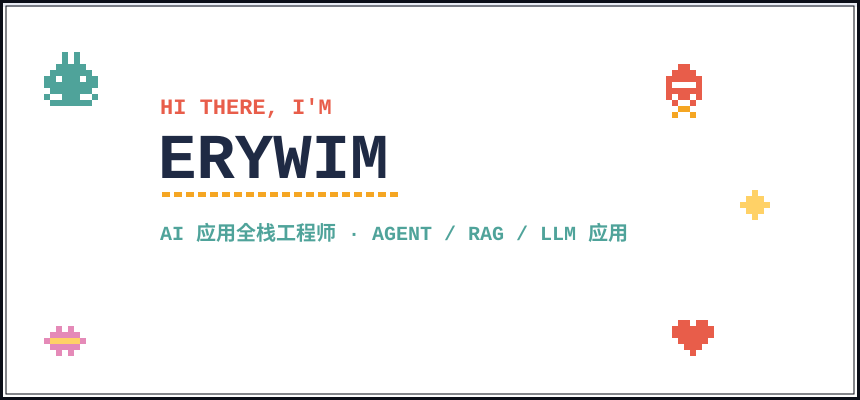

  

  <strong>AI Full-Stack Engineer · Agent Systems / RAG / LLM</strong> 
  Turning model capabilities into products that hold up in production.

  
  
  

## 👋 About Me

I'm an AI full-stack engineer focused on turning LLM capabilities into products that hold up in production. I work across agent orchestration, retrieval, backend systems, and multi-platform interaction.

- 🔭 Currently building [pi-amadeus](https://github.com/erywim/pi-amadeus), a personal assistant built on Pi Agent.
- 💼 Previously worked on AI full-stack (Agent) projects and Java backend systems.
- 🌱 Learning deep learning fundamentals and reading agent internals such as Claude Code and Hermes.
- 💬 Ask me about Agent engineering, RAG, Java, TypeScript, and shipping AI features end to end.
- 🎮 Off-screen: anime, photography, games, and turning random ideas into working software.

## 🛠️ Tech Stack

### AI & Agents

  
  
  
  
  
  
  

### Backend & Data

  
  
  
  
  
  
  
  
  
  

### Frontend & Interface

  
  
  
  
  
  
  

 

## 📊 GitHub Stats

  
  

  <picture>
    <source media="(prefers-color-scheme: dark)" srcset="https://raw.githubusercontent.com/erywim/Erywim/output/github-contribution-grid-snake-dark.svg">
    <source media="(prefers-color-scheme: light)" srcset="https://raw.githubusercontent.com/erywim/Erywim/output/github-contribution-grid-snake.svg">
    
  </picture>

